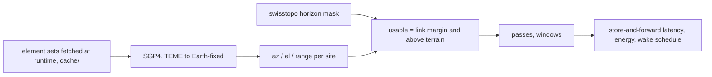

# sat-iot-pass-planner

Open-source pass planner for direct-to-satellite IoT uplinks from alpine sites: it combines public orbital elements (downloaded at runtime), swisstopo terrain horizons and a link budget to show when a battery device can really talk to a satellite, how long messages take, and what that costs in battery.


Simulated, not measured in the field. Same 24 satellites, same link: a deep valley floor loses about half of the usable passes to terrain, a ridge top loses none.

## What it does

- Downloads public element sets at runtime into a local cache and propagates them with SGP4 (verified against the published verification set) and converts to azimuth, elevation and range for a site.
- Builds a 360 degree terrain horizon mask per site from the swisstopo 2 m height model (committed, 2 degree azimuth steps, Earth curvature included).
- Applies a transparent link budget (868 MHz, 300 bit/s, 16 dBm EIRP, G/T -20 dB/K, 3 dB margin): the link only closes above a minimum elevation, and terrain can raise that limit further.
- Counts usable passes per day, contact windows, uplink and end-to-end latency (store-and-forward to a gateway), energy per day and battery life.
- Compares a pass-aware wake schedule with a blind periodic baseline and writes a JSON wake schedule per device.

## Results

Element sets fetched from CelesTrak on 2026-11-11 23:12 UTC (epochs of the satellites used: 2026-11-10 14:15 to 2026-11-11 15:09 UTC). Simulation start 2026-11-11 15:00 UTC, 7 days propagated, 24 satellites per orbit class drawn deterministically from that fetch (geometry only: inclination, altitude, eccentricity). Full tables for all five sites and three orbit classes: [`results/results.md`](results/results.md). A new fetch gives a different sample and start time, so numbers move by a few percent: an earlier run on elements from 2026-11-08 gave 44.6 vs 85.1 passes/day and 48% valley loss.

Orbit class `sso` (sun-synchronous class, mean altitude 483 km, link closes above 9.8 deg):

| Site | Ground m | Passes/day flat | Passes/day terrain | Lost | Uplink p50 / p95 min | End-to-end p50 / p95 min |
|---|---:|---:|---:|---:|---:|---:|
| Interlaken, open valley floor | 568 | 86.4 | 85.9 | 1% | 12 / 58 | 51 / 114 |
| Lauterbrunnen, narrow valley floor | 788 | 86.3 | 46.0 | 47% | 24 / 117 | 63 / 162 |
| Foot of the Eiger north face | 1618 | 86.1 | 82.6 | 4% | 13 / 57 | 38 / 117 |
| Kleine Scheidegg, saddle | 2057 | 86.1 | 79.3 | 8% | 13 / 68 | 41 / 123 |
| Schilthorn, ridge top | 2967 | 86.4 | 86.4 | 0% | 13 / 57 | 47 / 117 |

Other findings (see `results/results.md`):

- The valley loss depends on the orbit class: 15% (mid-inclination), 27% (near-polar), 47% (sun-synchronous class).
- Better satellite G/T does not help a deep valley: from -24 to -16 dB/K the ridge goes from 54.4 to 112.9 passes/day, the valley only from 42.1 to 46.0, because terrain, not the link, is the limit.
- Pass-aware scheduling vs a blind 15 minute repeat, valley, `sso`: 0.63 vs 1.81 mAh/day (battery about 7.8 vs 2.7 years in this model), median uplink latency 24 vs 97 min, delivery 100% vs 85% with a 6 h hold.

## Quick start

```bash
pip install -e ".[dev]"
python -m sat_iot_pass_planner validate                            # SGP4 + sidereal time vs published references
python -m sat_iot_pass_planner fetch-tle                           # download element sets into ./cache (one request, at most every 2 h)
python -m sat_iot_pass_planner demo --out results --figures docs   # runs on the cache (about 2 min); fetches first if the cache is empty
python -m sat_iot_pass_planner passes --site lauterbrunnen_valley --days 1
python -m sat_iot_pass_planner schedule --site schilthorn_ridge --hours 48 --out schedule.json
python -m sat_iot_pass_planner demo --synthetic --days 2 --out results_synth   # offline, made-up orbits
python -m pytest -q                                                # offline: synthetic element sets, network blocked
```

No orbital data is committed. `fetch-tle` (or the first `demo`/`passes`/`schedule` run) downloads one CelesTrak GP group into the gitignored `cache/` (set `SAT_IOT_CACHE_DIR` or `--cache-dir` to move it), stores it without object names together with the fetch time, and later runs reuse it. The client sends a User-Agent that names this project and refuses to download the same group again within 2 hours. `--no-fetch` turns the download off; `--synthetic` uses made-up element sets instead. A fresh fetch reproduces the method, not the exact digits above (those come from the fetch of 2026-11-11 23:12 UTC).

Link parameters can be changed with `--eirp-dbm`, `--gt-dbk`, `--freq-mhz`, `--rate-bps`.

## How it works



Usable means: above the geometric horizon, link margin at least the design margin, and elevation above the terrain mask at that azimuth. A pass counts when it offers at least 40 s of usable time (two bursts). The device has no downlink, so it repeats bursts instead of waiting for acknowledgements; each burst is received with probability 0.7 while a satellite is usable. Messages are delivered to a gateway at the satellite's next contact with one of two generic gateway sites (high-latitude north, mid-latitude south).

## Data sources

- Orbital elements: CelesTrak GP data (Source: CelesTrak, celestrak.org), group `active`, downloaded at runtime into the local, gitignored `cache/`. Not redistributed: CelesTrak states no licence or redistribution terms, so this repository commits no element sets. The README numbers use the fetch of 2026-11-11 23:12 UTC. Earlier commits contained a snapshot from 2026-11-08; it was removed from the current tree but remains in the git history.
- Tests and CI: synthetic element sets generated by `sat_iot_pass_planner/synthetic.py` from made-up orbital parameters (labelled `SYNTHETIC`, catalogue numbers from 80001, valid TLE layout and checksums). They describe no real object.
- Terrain: swisstopo swissALTI3D height profile service (Source: swisstopo; opendata.swiss "Open use, must provide the source"). Horizons in `sat_iot_pass_planner/data/horizons.json`, rebuild with `fetch-terrain`.
- Validation: the SGP4 verification set (Vallado, Crawford, Hujsak, Kelso, AIAA 2006-6753) shipped inside the `sgp4` package, and Vallado example 3-5 for sidereal time. Max position difference 1.7e-7 km over 710 reference states.

## What is not verified yet

- The README numbers depend on the fetch date: each fetch gives a different satellite sample and start time. Two fetches three days apart (2026-11-08, 2026-11-11) gave valley losses of 48% and 47%; more fetches have not been compared.
- Whether the 2026-11-08 snapshot still in the git history may be redistributed is unverified (CelesTrak states no terms).
- No field measurement: link budget values (EIRP, G/T, required Eb/N0, losses), reception probability, current draw and battery derating are typical assumptions, not the specification of any service.
- The terrain mask comes from a 2 m model sampled along 180 azimuths to 40 km; buildings, trees, snow and antenna pattern are not modelled. Sites are examples, antenna height 2 m.
- UTC is used as UT1 and polar motion is ignored (below 0.5 km position error); element sets age within days, so refetch and regenerate schedules when they are older than about 3 days.
- Gateways are generic locations, not a real network; end-to-end latency depends on that choice.
- Satellites in each orbit class are a random sample of public objects, not any operator's constellation.

## Licence

MIT, Copyright (c) 2026 VB-Builds.
