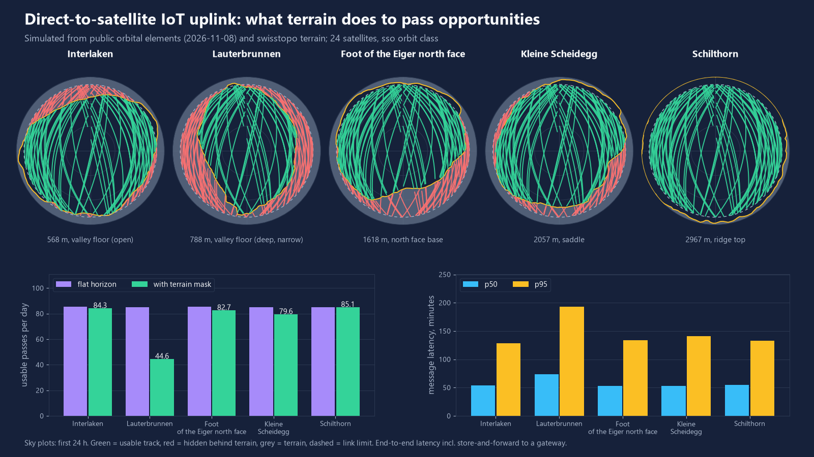
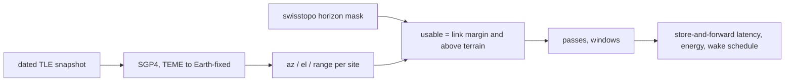

# sat-iot-pass-planner

Open-source pass planner for direct-to-satellite IoT uplinks from alpine sites: it combines public orbital elements, swisstopo terrain horizons and a link budget to show when a battery device can really talk to a satellite, how long messages take, and what that costs in battery.



Simulated, not measured in the field. Same 24 satellites, same link: a deep valley floor loses about half of the usable passes to terrain, a ridge top loses none.

## What it does

- Propagates real satellite element sets with SGP4 (verified against the published verification set) and converts to azimuth, elevation and range for a site.
- Builds a 360 degree terrain horizon mask per site from the swisstopo 2 m height model (committed, 2 degree azimuth steps, Earth curvature included).
- Applies a transparent link budget (868 MHz, 300 bit/s, 16 dBm EIRP, G/T -20 dB/K, 3 dB margin): the link only closes above a minimum elevation, and terrain can raise that limit further.
- Counts usable passes per day, contact windows, uplink and end-to-end latency (store-and-forward to a gateway), energy per day and battery life.
- Compares a pass-aware wake schedule with a blind periodic baseline and writes a JSON wake schedule per device.

## Results

Simulation start 2026-11-08 08:00 UTC, 7 days propagated, 24 satellites per orbit class drawn deterministically from a dated public snapshot (geometry only: inclination, altitude, eccentricity). Full tables for all five sites and three orbit classes: [`results/results.md`](results/results.md).

Orbit class `sso` (sun-synchronous class, mean altitude 481 km, link closes above 9.8 deg):

| Site | Ground m | Passes/day flat | Passes/day terrain | Lost | Uplink p50 / p95 min | End-to-end p50 / p95 min |
|---|---:|---:|---:|---:|---:|---:|
| Interlaken, open valley floor | 568 | 85.3 | 84.3 | 1% | 14 / 65 | 54 / 129 |
| Lauterbrunnen, narrow valley floor | 788 | 85.0 | 44.6 | 48% | 25 / 120 | 73 / 193 |
| Foot of the Eiger north face | 1618 | 85.3 | 82.7 | 3% | 14 / 63 | 53 / 134 |
| Kleine Scheidegg, saddle | 2057 | 85.1 | 79.6 | 7% | 14 / 65 | 53 / 141 |
| Schilthorn, ridge top | 2967 | 85.1 | 85.1 | 0% | 15 / 62 | 55 / 133 |

Other findings (see `results/results.md`):

- The valley loss depends on the orbit class: 16% (mid-inclination), 26% (near-polar), 48% (sun-synchronous class).
- Better satellite G/T does not help a deep valley: from -24 to -16 dB/K the ridge goes from 52.7 to 111.6 passes/day, the valley only from 41.6 to 44.6, because terrain, not the link, is the limit.
- Pass-aware scheduling vs a blind 15 minute repeat, valley, `sso`: 0.58 vs 1.74 mAh/day (battery about 8.5 vs 2.8 years in this model), median uplink latency 25 vs 109 min, delivery 100% vs 73% with a 6 h hold.

## Quick start

```bash
pip install -e ".[dev]"
python -m sat_iot_pass_planner validate                            # SGP4 + sidereal time vs published references
python -m sat_iot_pass_planner demo --out results --figures docs   # reproduces the numbers above (about 2 min)
python -m sat_iot_pass_planner passes --site lauterbrunnen_valley --days 1
python -m sat_iot_pass_planner schedule --site schilthorn_ridge --hours 48 --out schedule.json
python -m sat_iot_pass_planner fetch-tle --group active            # refresh the snapshot (CelesTrak: max one request per group per 2 h)
python -m pytest -q
```

Link parameters can be changed with `--eirp-dbm`, `--gt-dbk`, `--freq-mhz`, `--rate-bps`.

## How it works



Usable means: above the geometric horizon, link margin at least the design margin, and elevation above the terrain mask at that azimuth. A pass counts when it offers at least 40 s of usable time (two bursts). The device has no downlink, so it repeats bursts instead of waiting for acknowledgements; each burst is received with probability 0.7 while a satellite is usable. Messages are delivered to a gateway at the satellite's next contact with one of two generic gateway sites (high-latitude north, mid-latitude south).

## Data sources

- Orbital elements: CelesTrak GP data (celestrak.org), group `active`, fetched 2026-11-08, object names removed, filtered to three orbit classes. Stored in `sat_iot_pass_planner/data/`.
- Terrain: swisstopo swissALTI3D height profile service (Source: swisstopo, open government data). Horizons in `sat_iot_pass_planner/data/horizons.json`, rebuild with `fetch-terrain`.
- Validation: the SGP4 verification set (Vallado, Crawford, Hujsak, Kelso, AIAA 2006-6753) shipped inside the `sgp4` package, and Vallado example 3-5 for sidereal time. Max position difference 1.7e-7 km over 710 reference states.

## What is not verified yet

- No field measurement: link budget values (EIRP, G/T, required Eb/N0, losses), reception probability, current draw and battery derating are typical assumptions, not the specification of any service.
- The terrain mask comes from a 2 m model sampled along 180 azimuths to 40 km; buildings, trees, snow and antenna pattern are not modelled. Sites are examples, antenna height 2 m.
- UTC is used as UT1 and polar motion is ignored (below 0.5 km position error); element sets age within days, so regenerate schedules when they are older than about 3 days.
- Gateways are generic locations, not a real network; end-to-end latency depends on that choice.
- Satellites in each orbit class are a random sample of public objects, not any operator's constellation.

## Licence

MIT, Copyright (c) 2026 Victor Bonilla.
